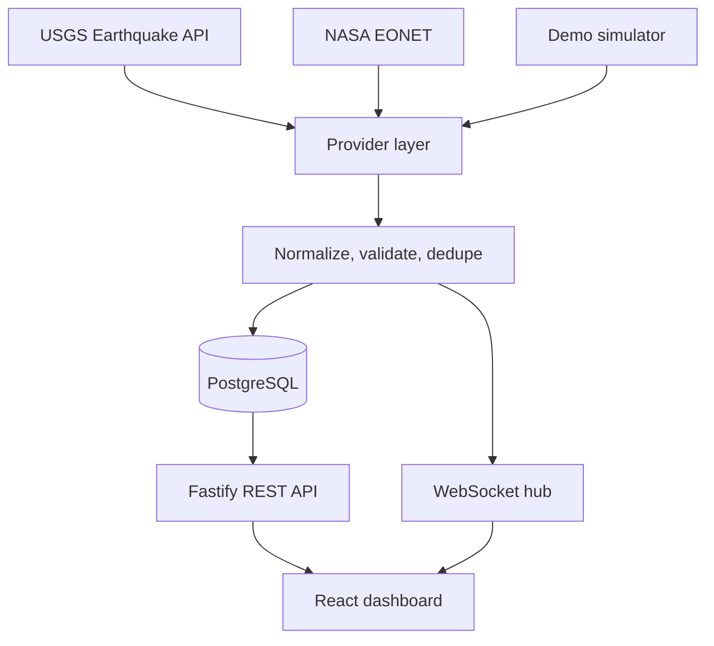
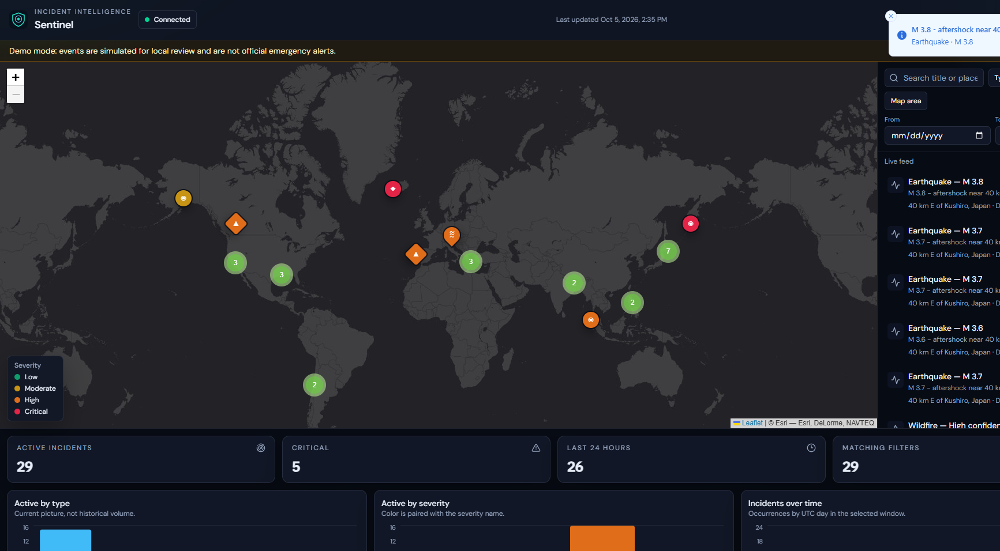
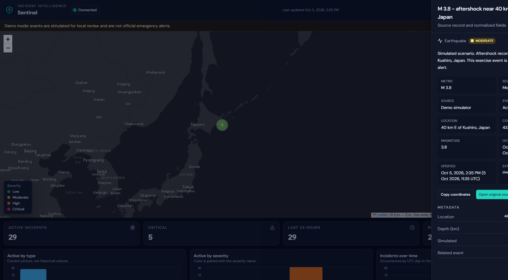

# Sentinel

Sentinel is a real-time incident intelligence dashboard. It ingests public hazard feeds, normalizes them into one incident model, stores them in PostgreSQL, and pushes changes to a command-center UI over WebSockets. Earthquakes come from the USGS. Wildfires, storms, floods, and volcanic events come from NASA EONET. A demo simulator runs the same pipeline when those feeds are unreachable, so the project can be reviewed locally without API keys.

## Features

- Provider architecture for USGS, NASA EONET, and a demo simulator
- Polling with timeouts, exponential backoff, deduplication, and failure isolation
- Normalized incidents persisted in PostgreSQL with Prisma
- REST API for search, filters, pagination, statistics, and nearby lookup
- WebSocket deltas for created, updated, and resolved incidents
- Dark command-center UI with an interactive clustered map, live feed, filters, and charts
- Compound situations when different hazards occur within 200 km, drawn on the map and named in a live brief
- Revision history for magnitude, severity, confidence, containment, and resolution
- A scripted one-minute demo exercise: Ridgecrest is revised, an aftershock arrives, and the Angeles fire is raised to critical
- Reconnecting WebSocket client, loading and empty states, and accessible severity labels
- Docker Compose, GitHub Actions, Vitest coverage, and structured Pino logs

## Architecture



`packages/shared` owns the incident contract, filter matching, and realtime event schemas. `apps/api` owns ingestion and HTTP. `apps/web` owns the dashboard. Route handlers do not call external APIs, and React components do not implement filter or cache rules.

## Tech stack

- React 19, TypeScript, Vite, Tailwind CSS, Radix UI primitives, TanStack Query, Zustand, React Router
- Leaflet and marker clustering, Recharts, Lucide
- Node.js, Fastify, Zod, Pino, Prisma, PostgreSQL
- Vitest, React Testing Library, Docker Compose, GitHub Actions

## Screenshots



The operating picture: clustered incidents on a dark basemap, a live feed, and severity charts. Selecting an incident opens the source record and moves the map.



## Getting started

Requirements: Node.js 22, pnpm 10, and Docker for PostgreSQL.

```bash
cp .env.example .env
docker compose up db -d
pnpm install
pnpm db:generate
pnpm db:migrate
pnpm dev
```

- Dashboard: http://localhost:5173
- API: http://localhost:3001/api/health

Postgres is published on host port `5433` so it does not collide with a local PostgreSQL already using `5432`. Inside Compose, the API still reaches the database at `db:5432`.

`pnpm dev` starts the API and the Vite dev server. Vite proxies `/api` and `/ws`, so the browser stays on one origin.

The default configuration is `DEMO_MODE=true`. The API loads a worldwide simulated catalog immediately, then creates, revises, and resolves incidents about every 15 seconds. The banner in the UI states that these events are exercises, not official alerts.

To use live public feeds:

```bash
DEMO_MODE=false
```

No API key is required. USGS and NASA EONET are public.

Optional seed of the same simulated catalog:

```bash
pnpm db:seed
```

The seed command refuses to run when `DEMO_MODE=false`.

## Environment variables

| Variable               | Purpose                                                                           |
| ---------------------- | --------------------------------------------------------------------------------- |
| `DATABASE_URL`         | PostgreSQL connection string for Prisma                                           |
| `PORT`                 | API port. Default `3001`                                                          |
| `HOST`                 | API bind address. Default `0.0.0.0`                                               |
| `NODE_ENV`             | `development`, `test`, or `production`                                            |
| `LOG_LEVEL`            | Pino level                                                                        |
| `CORS_ORIGIN`          | Comma-separated browser origins allowed to call the API directly                  |
| `DEMO_MODE`            | `true` uses the simulator. `false` polls USGS and EONET                           |
| `POLLING_INTERVAL_MS`  | Provider poll interval. Minimum `5000`                                            |
| `USGS_API_URL`         | USGS GeoJSON feed. Default is magnitude 2.5+ for the past day                     |
| `WILDFIRE_API_URL`     | NASA EONET events endpoint used for wildfires, storms, floods, and related events |
| `PROVIDER_TIMEOUT_MS`  | Upstream timeout                                                                  |
| `PROVIDER_MAX_RETRIES` | Retries after a failed upstream call                                              |

Invalid configuration fails at startup with the variable name and reason. Secrets are not logged. The frontend has no API keys.

## Running with Docker

```bash
docker compose up --build
```

- Dashboard: http://localhost:8080
- API: http://localhost:3001/api/health
- Postgres: `localhost:5433` with user, password, and database `sentinel`

Compose starts Postgres, migrates the schema, and runs the API in demo mode. Nginx serves the dashboard and proxies `/api` and `/ws`.

Stop it with `docker compose down`. Add `-v` to remove the database volume.

## Testing

```bash
pnpm test
pnpm test:coverage
pnpm lint
pnpm typecheck
pnpm build
```

API tests cover normalization, deduplication, snapshot sync, ingestion failure handling, REST behavior, and a WebSocket client. They use an in-memory repository, so they do not need Postgres. The web tests cover formatting, filters, feed selection, and realtime cache updates.

## API

| Method | Path                    | Purpose                                                    |
| ------ | ----------------------- | ---------------------------------------------------------- |
| `GET`  | `/api/health`           | API and database status                                    |
| `GET`  | `/api/incidents`        | Filtered, paginated incidents                              |
| `GET`  | `/api/incidents/:id`    | Incident detail                                            |
| `GET`  | `/api/incidents/stats`  | Active, critical, 24h, type, severity, and timeline counts |
| `GET`  | `/api/incidents/nearby` | Active incidents within a radius                           |
| `GET`  | `/api/providers/status` | Provider sync health and demo mode                         |

Details and examples are in [docs/API.md](docs/API.md).

## WebSocket events

Connect to `/ws`.

| Event              | Meaning                                                         |
| ------------------ | --------------------------------------------------------------- |
| `INCIDENT_CREATED` | New normalized incident stored                                  |
| `INCIDENT_UPDATED` | Material change to a stored incident                            |
| `INCIDENT_REMOVED` | Incident missing from a successful snapshot and marked resolved |
| `SYSTEM_STATUS`    | Connection snapshot and provider health                         |

The dashboard reconnects with exponential backoff and shows Connecting, Connected, Reconnecting, or Offline.

## Architecture decisions

- **EONET instead of FIRMS.** NASA FIRMS is a thermal-hotspot feed and needs a MAP key. A global day of hotspots is the wrong granularity for an incident list. EONET is public, event-level, and covers wildfire, severe weather, flood, and volcanic activity. USGS remains the earthquake source.
- **One incident model.** Providers return `NormalizedIncident`. The API and UI share the Zod-inferred `Incident` type. Adding a source means a new provider, not a new table.
- **Deltas after the first sync.** The initial snapshot is loaded with REST. Later polls broadcast only creates, updates, and removals. An empty upstream payload does not resolve the stored catalog.
- **Bounding box plus haversine.** Nearby search uses a latitude/longitude index as a coarse filter and haversine for the radius. PostGIS would be the next step; the official Postgres image keeps the demo easy to run.
- **In-memory repository in tests.** Query behavior is tested without a database. Prisma implements the same repository contract in production.
- **Same-origin proxy.** Vite in development and Nginx in Docker proxy the API and WebSocket, so credentials never need to live in frontend code.
- **Situations are derived, not stored.** A compound situation is two active incidents of different types within 200 km, with at least one high or critical. The brief and the map links are computed from the current view, so filters stay consistent.
- **Revisions are the reason an update happened.** Material changes append a short record (magnitude, severity, confidence, containment, or resolution). The detail sheet shows that log. The row itself stays the current source record.

## Future improvements

- PostGIS for true spatial indexes
- Optional NASA FIRMS hotspot layer, aggregated before it reaches the map
- Saved alert rules and notification channels
- Authenticated operator accounts and an audit log
- OpenTelemetry traces across a provider sync
- Historical playback of a shift

## License

MIT. See [LICENSE](LICENSE).
